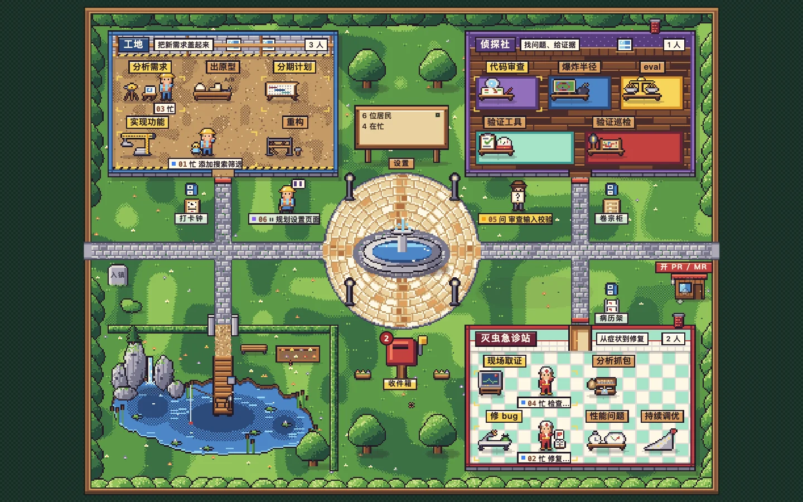
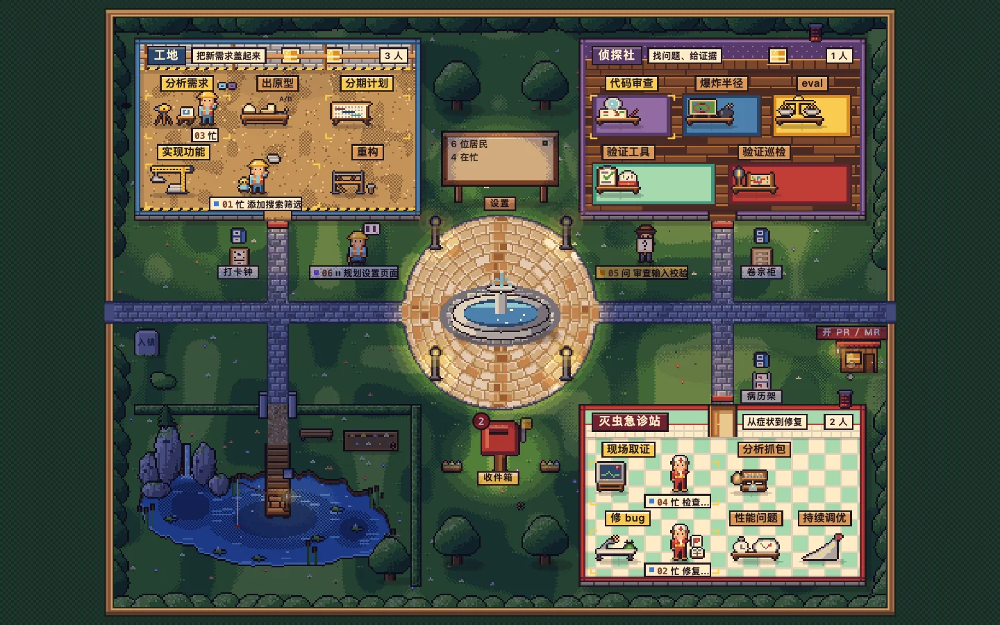
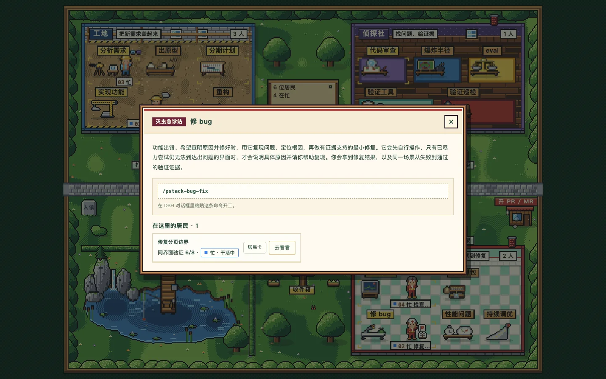
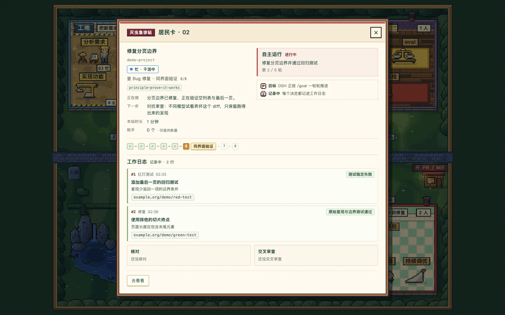

# Pixel Town · pixel-town-pstack

[English](README.md) · [简体中文](README.zh.md)

A pixel-town view of your **DeepSeek Harness (DSH) sessions**, with **pstack skills** for the work behind them. Sessions become residents, buildings group kinds of work, and wooden plaques open the corresponding playbooks. The town shows reported progress and recorded evidence; it does not prove that an agent is correct.

This is an **unofficial community plugin**, not an official DeepSeek, Cursor, or pstack product.

## A look around

| Day | Night |
| --- | --- |
|  |  |
| Choose a playbook | Inspect a resident |
|  |  |

## Requirements

- **DSH** installed, with its `dsh` CLI available. Tested against DSH **0.2.1-rc.5** and desktop **0.2.2-rc.1**; this is not a compatibility claim for every release.
- **Node.js 22 or newer**; the package minimum is **22.13.0**. DSH itself may require a newer Node version.
- **pnpm** and **Git**.
- For assigning child-agent models: enable DSH's **Plugins → Subagents → Model selection** and allow the models you intend to use.

## Install from source

There is **no npm release**. Clone, build, and link the local checkout. Replace `<profile>` with the DSH profile you use:

```sh
git clone https://github.com/xianxianxianyu/pixel-town-pstack.git
cd pixel-town-pstack
pnpm install --frozen-lockfile
pnpm build
dsh plugin --profile <profile> add link:"$(pwd)"
```

Restart DSH, then open **Pixel Town / 像素小镇** in the left sidebar. The panel uses DSH's existing authentication on the same origin; it needs no separate token URL. Keep the linked checkout in place. After updating it, install dependencies and rebuild, then restart DSH to refresh the host, tools, skill catalog, and client bridge.

## Choose a playbook

Click a plaque, select a workspace, and choose **新开会话** (new session). DSH opens a new or blank conversation and inserts an **unsent** slash-command draft; add your task and send it yourself. An existing draft is preserved. You can also paste any command below directly into a DSH conversation.

All **15 plaques** are runnable. Buildings are categories, not sequential workflow stages; the park is a quiet corner, not a sixteenth workflow.

| Building | Plaque | Command | Use it for |
| --- | --- | --- | --- |
| 工地 · Construction site | 分析需求 | `/pstack-investigation` | Understand code or a requirement without changing it. |
| 工地 · Construction site | 出原型 | `/pstack-prototype` | Compare disposable alternatives before choosing a direction. |
| 工地 · Construction site | 分期计划 | `/pstack-multi-phase-plan` | Write an evidence-bearing phased plan; implement only after an explicit go. |
| 工地 · Construction site | 实现功能 | `/pstack-feature` | Design, implement, and verify a requested feature. |
| 工地 · Construction site | 重构 | `/pstack-refactoring` | Simplify structure while proving behavior stays the same. |
| 侦探社 · Detective agency | 代码审查 | `/pstack-interrogate` | Attack a diff in isolated worktrees and report reproduced bugs without fixing them. |
| 侦探社 · Detective agency | 爆炸半径 | `/pstack-blast-radius` | Investigate downstream risks and test the assumptions behind a change. |
| 侦探社 · Detective agency | eval | `/pstack-eval` | Compare controlled candidates, judge anonymous outputs, and audit actual artifacts. |
| 侦探社 · Detective agency | 验证工具 | `/pstack-create-verification-skill` | Create and exercise a project-specific real-app verification skill. |
| 侦探社 · Detective agency | 验证巡检 | `/pstack-maintain-verification-skill` | Check every mapped feature and repair the verification skill, not product code. |
| 灭虫急诊站 · Bug clinic | 现场取证 | `/pstack-runtime-forensics` | Diagnose a running incident, then ask whether to fix it. |
| 灭虫急诊站 · Bug clinic | 分析抓包 | `/pstack-trace-forensics` | Analyze an existing profile, trace, heap snapshot, or log without changing code. |
| 灭虫急诊站 · Bug clinic | 修 bug | `/pstack-bug-fix` | Reproduce a bug, fix its cause, and verify the original surface. |
| 灭虫急诊站 · Bug clinic | 性能问题 | `/pstack-perf-issue` | Measure a performance problem, make a targeted change, and remeasure. |
| 灭虫急诊站 · Bug clinic | 持续调优 | `/pstack-hillclimb` | Iterate toward a measured target and retain only supported improvements. |

### The delivery exit

The **开 PR / MR** exit uses **`/pstack-opening-a-pr`**, a shared delivery skill, not another plaque. Implementation workflows load it at delivery; the exit can also open an unsent draft for an existing change. It guides ordered commits and a ready GitHub PR or GitLab MR when the remote, CLI, and user's workflow permit, otherwise honest local delivery. It does not merge or babysit the result.

The town and its host tools do **not autonomously commit, push, or open PRs/MRs**. An agent following the selected skills can run repository commands, including delivery actions under `pstack-opening-a-pr`; choosing a plaque is not a background Git automation service.

## Read and control a session

### Residents, badges, and inbox

- A resident's station and card show its reported stage, skipped or revisited stages, handoffs, child agents, and token usage. Token totals include repeated context reads; they are not unique text or a monetary estimate.
- The **目标** flag displays a native DSH goal started with `/goal <objective>`. DSH owns autonomous goal execution; the town only displays it.
- **最新图表** (latest chart) appears on a resident card once the session's agent has checked a diagram with the `dsh-canvas` plugin's `canvas_check`. It opens the conversation with that file in DSH's right sidebar; without dsh-canvas installed the file opens as plain text. Every workflow tells the agent to draw with the `canvas-diagram` skill when it is available and otherwise to answer with a `mermaid` code block.
- The **记录中** notebook badge marks an enabled decision trail. Save, pause, and lightning badges distinguish a checkpoint from an interrupted turn.
- The central **收件箱** (inbox) collects questions and approvals, saved sessions waiting for you, and interruptions. **去回答 / 去看看** opens the conversation; the town never answers, approves, resumes, or submits on your behalf.
- The notice board provides overview, settings, model roles, residents, and **最近离开** (recent departures). Completed sessions leave the map; recorded PR/MR/local delivery is shown at the exit. Quiet mode and system reduced motion stop ambient animation.

### Save points and `/pstack-pause`

Each building has a save point: the construction site's time clock, the detective agency's file cabinet, and the clinic's medical-record rack. Use **`/pstack-pause [reason]`** to request a safe boundary in an active workflow. The command asks the agent to interrupt its running children, avoid further code changes and irreversible actions, call `pstack_pause`, and end the reply.

A checkpoint includes intent, completed work, current state, next action, relevant files, and uncommitted paths. The tool writes a readable resume note; it does not commit, stash, or edit your repository. A stop button, crash, or error is **not** a save point and cannot retroactively create a checkpoint. Continue in the DSH conversation when ready.

### Decision trails and `/pstack-trail`

Trails start automatically for new `hillclimb` and `multi-phase-plan` runs. Use **`/pstack-trail [note]`** to enable one for another active workflow. `pstack_log` records decisions with evidence pointers; `pstack_audit` checks for mechanical gaps, exports the trail and transcript, and records a separate review. Inspect rows, supersession, audit findings, review flags, and cited tool output in the resident card.

New call evidence is explicitly tagged `kind: "invocation"` and stores a session-unique reference: `seq:<call-event-seq>`, or an encoded turn/step/provider-ID tuple for older records. Historical `kind: "call"` rows always mean opaque provider IDs and retain their last-match behavior, even when an ID looks like an invocation reference. Relative pointers resolve when logged; copy a returned canonical pointer as `invocation:<ref>`.

Audit findings are not correctness gates. A same-family review must be disclosed; it is not an independent cross-family evaluation.

### Model roles

First enable selection and tick allowed models in **DSH → 插件 → 子智能体 → 模型选择**. Then open **告示牌 → 设置 → 模型分工** in the town:

| Role | Maximum assigned routes |
| --- | --- |
| Worker / 干活方 | 1 |
| Reviewer / 审查方 | 3 |
| Eval candidate / 候选 | 4 |
| Eval judge / 评审 | 1 |

Only DSH-authorized routes and catalog-supported reasoning levels are offered. Empty roles use runtime defaults: interrogate gets two default-model adversaries; eval gets one default candidate. An independent eval judge still needs a different model family. Settings and newly loaded skill instructions apply to **new sessions**; the main model remains the one you choose in DSH's composer. Unavailable model selection disables the controls instead of pretending to route models.

## Data, privacy, and limits

The default plugin data directory is **`~/.dsh/pixel-town-pstack/`** (under `DSH_HOME` when customized):

| Path | Contents |
| --- | --- |
| `resume/<sessionId>.md` | Latest readable checkpoint note. |
| `models.json` | Model-role assignments. |
| `trails/<sessionId>.tsv` | Exported decision rows. |
| `trails/<sessionId>.transcript.md` | Review transcript export, excluding reasoning. |

These files can contain workspace paths, task text, and tool output. Keep them private unless deliberately reviewed for sharing. DSH retains its own sessions; committed session events, not the exported notes, are authoritative.

- **No plugin telemetry or analytics.** This does not change DSH's or your model providers' network behavior.
- The live board includes **only sessions mounted in the current DSH process**, not every session on disk. The replay CLI can inspect stored logs.
- Integration currently uses DSH's **deprecated `snapshotEvents()` API**. Compatibility with future DSH releases is not guaranteed.
- Workflow reports describe agent progress, not verified success. Stages may be skipped, revisited, or switched; the plugin does not enforce evidence gates or skill instructions.
- Child-model routing requires DSH's subagent model-selection service. Headless or older hosts may not provide the same routing support; fallbacks must be disclosed.
- **Eval is not fully blinded or filesystem-isolated.** Shared runtime context and filesystem access can expose organizer paths or materials despite neutral names. No eligible independent family means independent judging is skipped, not silently replaced.
- Standalone pages offer copyable commands. One-click draft creation and navigation require the supported embedded DSH bridge; the board never sends a prompt automatically.
- Private evaluation materials and the private `town-ui-proof` browser harness are **not included**. The public tests and screenshots are not a claim that those private evaluations are reproducible from this repository.

## Development

```sh
pnpm install --frozen-lockfile
pnpm build
pnpm test
pnpm typecheck
node scripts/check-public.mjs
```

The privacy check scans Git-listed files in both the working tree and the staged index, including binary metadata and symlink targets. It reports locations without echoing sensitive values; fixing a staged finding also requires staging the correction.

Optionally put local-only, case-insensitive literal substrings in the ignored root file `check-public.local.txt`, one per line; blank lines are ignored.

The development helper uses an isolated **`pixel-town-pstack-dev`** profile on port **3998**, under `DSH_HOME` when set or the default DSH home otherwise:

```sh
sh scripts/dev-server.sh
# Choose another port if needed:
PORT=4000 sh scripts/dev-server.sh
```

The helper targets the macOS desktop installation and uses its bundled DSH CLI; additional CLI arguments are forwarded. It initializes a default DeepSeek-account model on first launch, so a signed-in account is needed to run agents. Sign in using the URL printed by DSH, then open Pixel Town. The standalone scene is at `http://127.0.0.1:3998/api/pixel-town-pstack/town/`. Board assets are served from disk; host and bundled client changes require rebuilding and restarting DSH.

Inspect a stored session after building (replace the example path with your own):

```sh
node scripts/replay.mjs /path/to/session-directory
node scripts/replay.mjs --cost --json /path/to/session-directory
```

Compressed `.zstd` logs additionally require `zstd` on `PATH`. See [Architecture](docs/architecture.md) for the event fold, API, bridge, storage, model routing, and output cap.

## Credits

- **[pstack](https://github.com/cursor/plugins/tree/main/pstack)**, by **Lauren Tan ([poteto](https://x.com/poteto))**, supplies the playbooks and engineering methodology adapted into these DSH skills. Upstream: **MIT**, Copyright (c) 2026 Lauren Tan.
- **[DeepSeek Harness (DSH)](https://github.com/deepseek-ai/deepseek-harness)**, by **DeepSeek**, provides the host, sessions, tools, subagents, and UI APIs. Upstream: **MIT**, Copyright (c) 2026 DeepSeek.
- The bundled YAML parser is **[yaml](https://github.com/eemeli/yaml)** by Eemeli Aro, licensed under ISC.

This community adaptation is not endorsed by those upstream projects. Their original notices are preserved in [Third-party notices](THIRD_PARTY_NOTICES.md).

## License

**AGPL-3.0-or-later** — Copyright (C) 2026 xianxianxianyu. See [LICENSE](LICENSE) for the GNU Affero General Public License, version 3; you may use this project under that version or any later version. Upstream components retain their original notices and licenses as recorded in [Third-party notices](THIRD_PARTY_NOTICES.md).

If you distribute a modified version, provide its corresponding source under the AGPL, including the changes and build/install scripts required by the license. If users interact with your modified version over a network, offer those users its corresponding source at no charge as required by the AGPL.
