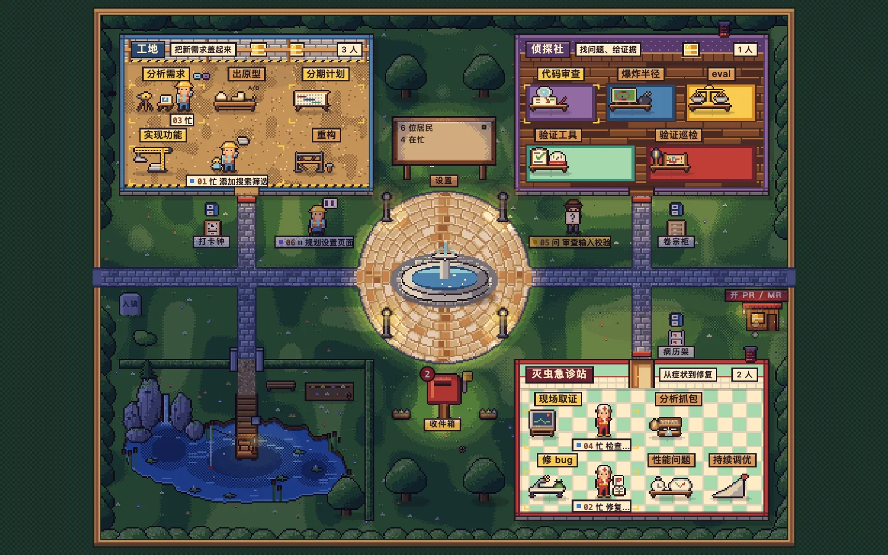
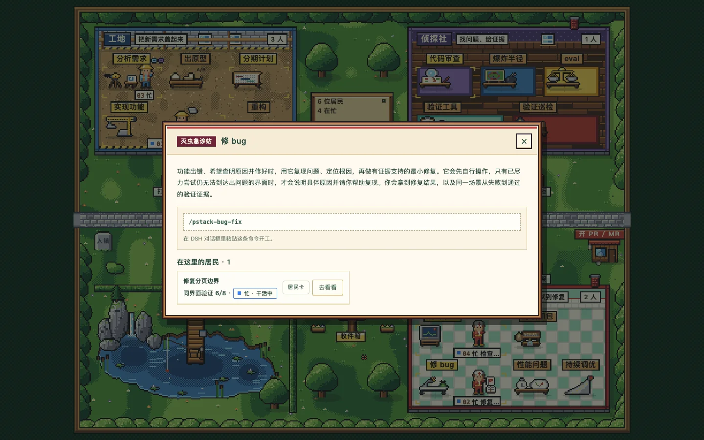
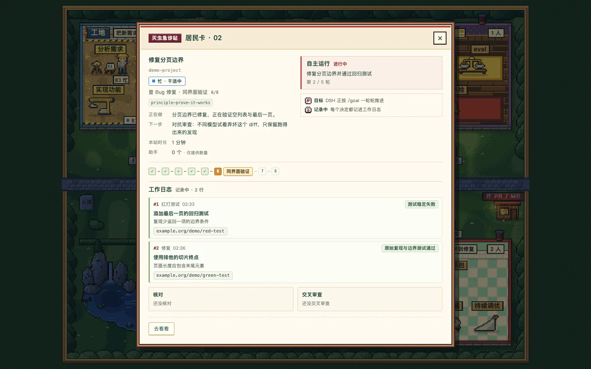

# 像素小镇 · pixel-town-pstack

[English](README.md) · [简体中文](README.zh.md)

把 **DeepSeek Harness（DSH）会话**变成像素小镇里的居民，用 **pstack skills** 指导背后的工作。建筑按工作类型分区，木牌对应可以直接启动的 playbook。小镇展示智能体报告的进度和已记录的证据，**不证明智能体做对了**。

这是一个**非官方社区插件**，不是 DeepSeek、Cursor 或 pstack 的官方产品。

## 逛逛小镇

| 白天 | 夜晚 |
| --- | --- |
|  |  |
| 选择工作流程 | 查看居民 |
|  |  |

## 环境要求

- 已安装 **DSH**，且可以在命令行使用 `dsh`。已测试 DSH **0.2.1-rc.5** 和桌面版 **0.2.2-rc.1**；这不表示兼容所有版本。
- **Node.js 22 或更新版本**；本包的最低要求是 **22.13.0**。DSH 自身可能要求更高版本。
- **pnpm** 和 **Git**。
- 如需指定子智能体模型，先在 DSH 的**插件 → 子智能体 → 模型选择**中启用选择，并勾选允许使用的模型。

## 从源码安装

目前**没有 npm 发布版本**。请克隆仓库、构建，再链接本地目录。将 `<profile>` 替换成你使用的 DSH profile：

```sh
git clone https://github.com/xianxianxianyu/pixel-town-pstack.git
cd pixel-town-pstack
pnpm install --frozen-lockfile
pnpm build
dsh plugin --profile <profile> add link:"$(pwd)"
```

重启 DSH，在左侧栏打开 **像素小镇 / Pixel Town**。面板与 DSH 同源，使用已有登录状态，不需要另外的 token URL。请保留被链接的源码目录。更新源码后重新安装依赖并构建，再重启 DSH，才能刷新宿主代码、工具、技能目录和客户端桥接。

这次形式化技能更新，**请先退出 DSH，再更新实时链接的 checkout**；重建该目录的 `lib/`，构建成功后再启动。旧宿主会在技能目录缓存未命中时读取新的技能文件，却不认识新流程 id；只更新文件、或未构建就重启，都可能使小镇的整个技能目录消失。木牌的“尚未接入”提示只保护点击，不解决技能提供器的版本不兼容。

## 选择工作流程

点击木牌，选择工作区，再点**新开会话**。DSH 会打开一个新会话或空白会话，并填入**尚未发送**的斜杠命令草稿；补充任务后由你发送。已有草稿不会被覆盖。也可以直接把下表中的命令粘贴到 DSH 对话里。

更新并重启宿主后，全部 **17 块木牌**都可以启动。侦探社有七块，采用 **3+4** 排列；另外两栋楼各五块。建筑是工作分类，不是工作流程中的先后阶段；公园是休息角落，不是另一条流程。旧宿主仍会显示新木牌，但点击后会说明尚未接入，不会提供不可用流程的开工按钮。

| 建筑 | 木牌 | 命令 | 适用任务 |
| --- | --- | --- | --- |
| 工地 | 分析需求 | `/pstack-investigation` | 理解代码或需求，不修改代码。 |
| 工地 | 出原型 | `/pstack-prototype` | 用一次性方案做对照，再决定方向。 |
| 工地 | 分期计划 | `/pstack-multi-phase-plan` | 编写带证据要求的分期计划，明确获准后才实施。 |
| 工地 | 实现功能 | `/pstack-feature` | 设计、实现并验证用户要求的功能。 |
| 工地 | 重构 | `/pstack-refactoring` | 简化结构，并证明行为不变。 |
| 侦探社 | 代码审查 | `/pstack-interrogate` | 在隔离 worktree 中攻击 diff，只报告复现的问题，不修复。 |
| 侦探社 | 爆炸半径 | `/pstack-blast-radius` | 调查下游风险，验证改动安全所依赖的事实。 |
| 侦探社 | eval | `/pstack-eval` | 对照候选方案、匿名评审结果，并核对实际产物。 |
| 侦探社 | 验证工具 | `/pstack-create-verification-skill` | 为项目生成并亲自跑通真实应用验证技能。 |
| 侦探社 | 验证巡检 | `/pstack-maintain-verification-skill` | 检查功能地图中的每项功能，只修验证技能，不改产品代码。 |
| 侦探社 | 形式化验证 | `/pstack-create-formal-verification-skill` | 验证普通测试难以覆盖的高风险性质，生成可复跑的项目技能。 |
| 侦探社 | 形式化巡检 | `/pstack-maintain-formal-verification-skill` | 按代码变更同步形式化检查，区分模型漂移与真实缺陷。 |
| 灭虫急诊站 | 现场取证 | `/pstack-runtime-forensics` | 诊断运行中的故障，再询问是否修复。 |
| 灭虫急诊站 | 分析抓包 | `/pstack-trace-forensics` | 分析已有 profile、trace、heap snapshot 或日志，不修改代码。 |
| 灭虫急诊站 | 修 bug | `/pstack-bug-fix` | 复现问题、修复根因，并在原界面验证。 |
| 灭虫急诊站 | 性能问题 | `/pstack-perf-issue` | 先测量，做针对性改动，再用相同条件复测。 |
| 灭虫急诊站 | 持续调优 | `/pstack-hillclimb` | 朝可测量目标迭代，只保留有证据支持的改进。 |

### 交付出口

**开 PR / MR** 出口使用 **`/pstack-opening-a-pr`**。它是共用的交付技能，不是另一块流程木牌。实现类流程在交付阶段加载它；也可以从出口为已有改动打开未发送的命令草稿。它指导整理有序提交，并在远端、命令行工具和用户工作方式允许时打开非草稿 GitHub PR 或 GitLab MR；条件不足时如实报告本地交付，不会继续合并或盯守。

小镇及宿主工具**不会自主提交、推送或创建 PR/MR**。智能体执行选定技能时可以运行仓库命令，包括遵循 `pstack-opening-a-pr` 进行交付；点击木牌不等于启动一个后台 Git 自动化服务。

### 形式化检查与状态图

形式化流程创建或维护 `<repo>/.dsh/skills/<name>/SKILL.md`，记录覆盖代码、边界、假设和最后同步的提交。必须用负向对照证明检查确实能失败；发现产品缺陷就如实报告，不弱化性质来换取通过。

**`/pstack-statechart`** 是共用工具技能，没有木牌。它检查 TLA+ 模型，用 `chart.mmd` 和 `report.md` 解释性质及最短反例路径。技能提供器注入安装后脚本的绝对路径和一行只读自检命令，生成的项目技能不保存机器相关路径。可用技能中有 `canvas-diagram` 时，把图复制到工作区模型旁，用 `canvas_check` 检查后以 `present` 交付；没有则输出 Mermaid 代码块及报告。

Statechart 需要 **Node ≥22.18**（Node 23 的原生 TypeScript 需要 ≥23.6）和 **Java/TLC**。可使用已由 `mise` 管理的 Temurin 25 与 TLC 1.7.4，或设置 `TLA2TOOLS` 指向 jar、`JAVA` 指向 Java 可执行文件（未设置 `JAVA` 时使用 `PATH` 上的 `java`）。先运行注入的 doctor；管理工具缺失时，上游 runner 会通过 `mise` 获取它们，**首次运行前必须征求用户同意，不擅自安装**。vendored runtime 没有 npm 运行时依赖，不打包测试或 `fast-check`。来源版本、运行时校验和及许可见[第三方声明](THIRD_PARTY_NOTICES.md)。

## 查看与控制会话

### 居民、徽章和收件箱

- 居民所在工位和卡片展示已报告阶段、跳过或重走的步骤、流程交接、子智能体和 token 用量。token 总数包含重复读取上下文，不是去重后的文本量，也不是金额估算。
- **目标**旗帜展示通过 `/goal <目标>` 启动的原生 DSH goal。自主执行由 DSH 负责，小镇只展示状态。
- 会话里的智能体用 [`dsh-canvas`](https://github.com/xianxianxianyu/dsh-canvas) 插件的 `canvas_check` 校验过图之后，居民卡片会出现**最新图表**按钮；完工离镇后，告示牌和出口的**最近离开**里仍保留这个按钮。点击打开对应对话，并在 DSH 右侧栏打开这张图；没装 dsh-canvas 时按纯文本显示。所有工作流程都提示智能体：有 `canvas-diagram` 技能就用它画图，否则输出 `mermaid` 代码块。
  相对图表路径按**调用时**的会话工作目录事件解析，不用最初的项目目录，也不用结果到达时的目录；绝对路径和 `~` / `~/…` 保持原样，由 DSH 在打开时展开主目录。`~user/…` 是普通相对路径，不做指定用户的主目录展开。历史调用若既是相对路径又没有记录工作目录，就不生成可能指错文件的图表链接。
- **记录中**笔记本徽章表示已启用工作日志。存档、暂停和闪电标记区分已有检查点与异常中断。
- 中央**收件箱**集中展示问题与审批、存档后等你的会话，以及中断。**去回答 / 去看看**只打开对应对话，不替你回答、批准、恢复执行或发送消息。
- 告示牌提供概况、设置、模型分工、居民和**最近离开**。已完成会话会离开地图；已记录的 PR/MR/本地交付显示在出口。安静模式和系统减少动态效果设置会停止环境动画。

### 存档点与 `/pstack-pause`

每栋建筑门口都有存档点：工地的打卡钟、侦探社的卷宗柜、急诊站的病历架。在已有工作流程的会话中使用 **`/pstack-pause [原因]`**，请求在安全边界停下。命令会要求智能体打断运行中的子智能体，不再修改代码或执行不可逆操作，调用 `pstack_pause`，然后结束回复。

检查点包括任务意图、已完成工作、当前状态、下一步、相关文件和未提交路径。工具只写可读的续接说明，不会提交、stash 或修改你的仓库。停止按钮、崩溃和报错**不是存档点**，也不能事后补造中断前的检查点。准备好后，在 DSH 对话里继续。

### 工作日志与 `/pstack-trail`

新的 `hillclimb` 和 `multi-phase-plan` 流程默认开启日志。其他已启动的流程可以用 **`/pstack-trail [说明]`** 开启。`pstack_log` 记录带证据指针的决策；`pstack_audit` 检查机械性缺口，导出日志和对话摘录，并记录独立复核。在居民卡片里可以查看记录、替代关系、审计发现、复核意见和引用的工具输出。

新的调用证据显式标记为 `kind: "invocation"`，并保存会话内唯一的引用：`seq:<调用事件序号>`；旧记录无序号时使用编码后的 turn/step/provider-ID 元组。历史 `kind: "call"` 记录始终将引用视为不透明的 provider ID，并保留最后匹配行为，即使该 ID 看起来像调用引用也不例外。相对指针在记日志时解析；复用返回的精确指针时使用 `invocation:<ref>`。

审计发现不是正确性关卡。同模型家族复核必须明确披露，不能当成跨家族独立评估。

### 模型分工

先在 **DSH → 插件 → 子智能体 → 模型选择**中启用选择并勾选允许的模型，再打开小镇的**告示牌 → 设置 → 模型分工**：

| 角色 | 最多配置的模型路由数 |
| --- | --- |
| 干活方 / Worker | 1 |
| 审查方 / Reviewer | 3 |
| 候选 / Eval candidate | 4 |
| 评审 / Eval judge | 1 |

面板只提供 DSH 授权的模型路由和模型目录支持的推理强度。未配置角色时使用运行时默认模型：代码审查默认两个对抗审查席位，eval 默认一个候选席位。独立 eval 评审仍须来自不同模型家族。设置及新加载的技能指令对**新会话**生效；主模型始终由 DSH 输入框中的选择决定。模型选择不可用时，面板会禁用控件，不会假装已经完成路由。

## 数据、隐私与限制

插件默认数据目录是 **`~/.dsh/pixel-town-pstack/`**（自定义 `DSH_HOME` 时位于对应目录下）：

| 路径 | 内容 |
| --- | --- |
| `resume/<sessionId>.md` | 最新的可读续接说明。 |
| `models.json` | 模型角色分配。 |
| `trails/<sessionId>.tsv` | 导出的决策记录。 |
| `trails/<sessionId>.transcript.md` | 不含 reasoning 的复核用对话摘录。 |

这些文件可能包含工作区路径、任务文字和工具输出，分享前请自行检查。DSH 自行保存会话；权威记录是已提交的会话事件，不是导出的说明文件。

- **插件没有遥测或分析上报。** 这不会改变 DSH 或模型服务商自身的网络行为。
- 实时小镇**只包含当前 DSH 进程中已挂载的会话**，不会遍历磁盘上的全部历史会话。可用回放 CLI 检查已保存日志。
- 当前集成使用 DSH **已弃用的 `snapshotEvents()` API**，不保证未来版本兼容。
- 流程报告表示智能体报告的进度，不表示验证成功。可以跳步、回退、切换流程；插件不强制证据关卡，也不强制执行技能文字中的约束。
- 子模型路由依赖 DSH 子智能体模型选择服务。无界面环境或旧宿主可能不提供同等支持，降级情况必须明确说明。
- **Eval 不是完全盲测，也不是文件系统隔离。** 即使使用中性名称，共享运行时上下文和文件系统权限仍可能暴露组织者的路径或材料。没有合格的独立模型家族时会跳过独立评审，而不是悄悄换成同家族模型。
- 独立页面提供可复制命令。一键创建草稿和跳转会话依赖受支持的 DSH 内嵌桥接；小镇绝不自动发送提示词。
- **未包含**私有评估材料和私有 `town-ui-proof` 浏览器验证工具。公开测试和截图不代表可以仅凭本仓库复现这些私有评估。

## 开发

```sh
pnpm install --frozen-lockfile
pnpm build
pnpm test
pnpm typecheck
node scripts/check-public.mjs
```

形式化木牌的行为测试使用独立临时 profile 和随机回环端口，在无头 Chrome/Chromium 中打开真实小镇，不启动 DSH。请自行安装浏览器，或把 `CHROME_BIN` 指向已有可执行文件；测试不会安装它。显式验证旧宿主时，将 `OLD_TOWN_WORKFLOWS` 指向移植前冻结的 `lib/workflows.js`，再运行 `node --test test/formal-board.test.mjs`。

隐私检查扫描 Git 列出的工作区文件和暂存区版本，包括二进制元数据与符号链接目标。报告只给出位置，不回显敏感值；修复暂存区中的问题后，也要将修正后的文件重新暂存。

可选地在仓库根目录被忽略的 `check-public.local.txt` 中填写仅供本地检查的字面子串，每行一项、不区分大小写，空行会被忽略。

开发脚本使用独立的 **`pixel-town-pstack-dev`** profile，默认端口为 **3998**；设置 `DSH_HOME` 时使用该目录，否则使用 DSH 默认主目录：

```sh
sh scripts/dev-server.sh
# 如需更换端口：
PORT=4000 sh scripts/dev-server.sh
```

脚本面向 macOS 桌面安装，使用应用附带的 DSH CLI，并转发额外命令行参数。首次启动会配置默认 DeepSeek 账户模型，因此运行智能体前需要登录。使用 DSH 输出的 URL 登录，然后打开像素小镇。独立场景地址是 `http://127.0.0.1:3998/api/pixel-town-pstack/town/`。小镇静态资源从磁盘读取；修改宿主或打包后的客户端需要重新构建并重启 DSH。

构建后可检查已保存的会话（将示例路径替换为你的路径）：

```sh
node scripts/replay.mjs /path/to/session-directory
node scripts/replay.mjs --cost --json /path/to/session-directory
```

读取 `.zstd` 压缩日志还需要 `PATH` 中有 `zstd`。事件折叠、API、桥接、存储、模型路由和输出上限见[架构说明](docs/architecture.md)。

## 致谢

- **[pstack](https://github.com/cursor/plugins/tree/main/pstack)** 的作者是 **Lauren Tan（[poteto](https://x.com/poteto)）**。本项目将其 playbook 与工程方法论改写为 DSH skills。上游许可为 **MIT**，Copyright (c) 2026 Lauren Tan。
- **[DeepSeek Harness（DSH）](https://github.com/deepseek-ai/deepseek-harness)** 由 **DeepSeek** 开发，提供宿主、会话、工具、子智能体与 UI API。上游许可为 **MIT**，Copyright (c) 2026 DeepSeek。
- 打包使用的 YAML 解析器 **[yaml](https://github.com/eemeli/yaml)** 由 Eemeli Aro 开发，采用 ISC 许可。

本社区改编不代表上述上游项目的认可或背书。原始许可声明保留于[第三方声明](THIRD_PARTY_NOTICES.md)。

## 许可

**AGPL-3.0-or-later** — Copyright (C) 2026 xianxianxianyu。[LICENSE](LICENSE) 提供 GNU Affero General Public License 第 3 版全文；本项目允许采用该版本或任意后续版本。上游组件的原始声明与许可见[第三方声明](THIRD_PARTY_NOTICES.md)。

如果分发修改后的版本，须按 AGPL 提供对应源码，包括修改内容以及许可要求的构建、安装脚本。如果用户通过网络与你修改后的版本交互，须按 AGPL 向这些用户免费提供该版本的对应源码。
